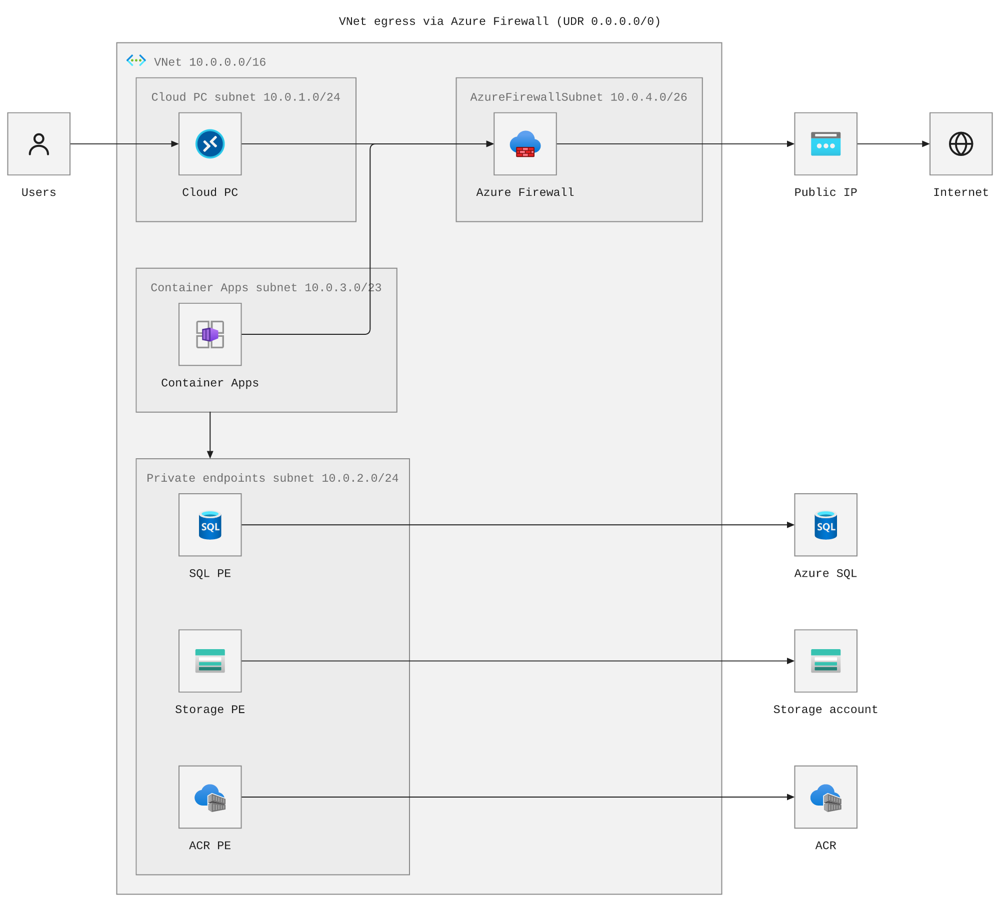

# pele-azure-diagrams

Azure architecture diagrams rendered from text.

Each diagram is written in [Mermaid](https://mermaid.js.org) syntax and rendered
to SVG with [Pele](https://github.com/obsidianmd/pele), using official Microsoft
Azure icons supplied through a small local icon resolver. No online service is
involved: the source and the rendered output both live in this repo.



## Convention: one diagram per folder

**Every diagram must be written and rendered in its own folder.** Do not drop
`.mmd` files at the repo root or mix several diagrams in one directory.

```text
diagrams/
└── <id>/
    ├── <id>.mmd        source - the only file you edit by hand
    ├── <id>.svg        rendered, uses Pele CSS variables (themable)
    ├── <id>.flat.svg   rendered, colors inlined (standalone)
    └── <id>.png        raster preview for docs and chat
```

Rules:

- The folder name and the file basename must match the diagram id, e.g.
  `diagrams/azure-vnet/azure-vnet.mmd`.
- Exactly one `.mmd` source per folder.
- Rendered files are generated. Do not edit them by hand; edit the `.mmd` and
  re-render.
- Commit the source **and** the rendered files, so the diagram is reviewable
  without running anything.

## Quick start

```sh
npm ci                      # install the pinned render toolchain

npm run render              # render every diagram in diagrams/
node render-azure.js azure-vnet   # render one diagram by id

npm run check               # report missing, stale, or orphaned diagrams
```

Both renderer dependencies are **dev-only and pinned to exact versions**
(`pele@1.6.0`, `@resvg/resvg-js@2.6.2`) with a committed `package-lock.json`, so
a render is reproducible. `.npmrc` sets `save-exact=true` to keep new installs
pinned too. Use `npm ci` rather than `npm install` so the lockfile is honored.

`npm run check` is what the local `find-missing-diagrams` skill runs. It exits
non-zero when a source has no render (missing), a render is older than its
source (stale), or a render has no source (orphan).

## Creating a diagram

1. Make the folder and the source:

   ```sh
   mkdir -p diagrams/my-diagram
   $EDITOR diagrams/my-diagram/my-diagram.mmd
   ```

2. Render it:

   ```sh
   node render-azure.js my-diagram
   ```

3. Confirm nothing is missing:

   ```sh
   npm run check
   ```

The renderer writes `<id>.svg`, `<id>.flat.svg`, and `<id>.png` next to the
`.mmd`.

## Writing the source

Diagrams use Mermaid `architecture-beta`, which models cloud topology with
groups (VNet, subnets) and services (resources). Icons are declared in
parentheses and labels in square brackets; `in` nests a component in a group.


> The `azure:*` icon names only resolve through this repo's renderer
> (`render-azure.js`). A plain Mermaid viewer - GitHub, VS Code, Obsidian,
> mermaid.live - has no Azure icon pack registered, so it falls back to a `?`
> placeholder for every icon. If you need a snippet that renders its icons
> anywhere, use Mermaid's built-in names (`cloud`, `database`, `disk`,
> `internet`, `server`).

Tips that matter for readable output:

- Set icon size with frontmatter so labels do not wrap:

  ```yaml
  ---
  config:
    architecture:
      iconSize: 64
  ---
  ```

- Edges attach to a side of each service: `a:R --> L:b`, `a:B --> T:b`.
- Use `align column a b` / `align row a b` to tidy siblings. Stack a fan of
  siblings with the same edge direction (for example several private endpoints
  all pointing right at their own service) so each gets its own clean arrow
  instead of the layout routing them as a chain.
- To connect two groups (subnets) instead of specific resources, keep one
  member on each side and use the group modifier, e.g.
  `ca{group}:B --> T:pesql{group}`.
- Give subnets a CIDR in the label; it doubles as documentation.

### Icon names

Names are resolved by `render-azure.js`. Use the `azure:` prefix for the bundled
Microsoft icons and a bare name for the built-in glyphs.

| In the diagram | Source |
| --- | --- |
| `azure:vnet` | `azure-icons/vnet.svg` |
| `azure:cloudpc` | `azure-icons/wvd.svg` (virtual desktop) |
| `azure:private-endpoint` | `azure-icons/private-endpoint.svg` |
| `azure:public-ip` | `azure-icons/public-ip.svg` |
| `azure:container-apps` | `azure-icons/container-apps.svg` |
| `azure:firewall` | `azure-icons/firewall.svg` |
| `azure:sql` | `azure-icons/sql.svg` |
| `azure:storage` | `azure-icons/storage.svg` |
| `azure:acr` | `azure-icons/acr.svg` |
| `azure:keyvault` | `azure-icons/keyvault.svg` |
| `azure:nsg` | `azure-icons/nsg.svg` |
| `azure:route-table` | `azure-icons/route-table.svg` |
| `users`, `internet` | line glyphs defined in `render-azure.js` |
| `cloud`, `database`, `disk`, `internet`, `server` | Pele built-ins |

Unknown names render as an empty slot. Add new icons by downloading the SVG into
`azure-icons/`, adding an entry to the `files` map in `render-azure.js`, and
using the new `azure:<name>` in a diagram.

The resolver strips each icon's outer `<svg>`, scales the artwork into Pele's
24x24 icon slot, and namespaces its gradient ids so icons cannot bleed into each
other. That last part is why icons go through a resolver instead of being pasted
into the diagram source.

## Icons and licensing

The SVGs under `azure-icons/` are Microsoft Azure architecture icons, gathered
from Microsoft and community mirrors. Microsoft permits their use in
architecture diagrams, training material, and documentation, but not in
marketing, and they must not be cropped, rotated, or distorted. Keep the product
name in the label next to the icon, which this repo's diagrams do.

## Skills

Project-local agent skills live in `.opencode/skills/`:

- **`find-missing-diagrams`** - checks that every `diagrams/<id>/` folder is
  complete and fresh. Run it directly, or via `npm run check`:

  ```sh
  .opencode/skills/find-missing-diagrams/scripts/find-missing-diagrams.sh
  ```

  It reports missing outputs, stale outputs, orphan outputs, and stray `.mmd`
  files outside `diagrams/`, then tells you which id to re-render.

These are local to this repo. They are not installed globally and do not affect
other projects.

## Files

| Path | Purpose |
| --- | --- |
| `render-azure.js` | Renderer: Mermaid -> SVG -> PNG, with the Azure icon resolver |
| `azure-icons/` | Shared Microsoft Azure SVG assets |
| `diagrams/` | One folder per diagram (source + renders) |
| `.opencode/skills/find-missing-diagrams/` | Local skill + script for finding incomplete diagrams |
| `package.json`, `package-lock.json`, `.npmrc` | Pinned dev toolchain (`npm ci`) |

## Notes

- The toolchain is build-time only, so `pele` and `@resvg/resvg-js` live in
  `devDependencies` at exact versions. Nothing here is installed into a
  consuming app.
- `pele` renders the SVG. `@resvg/resvg-js` is only used to produce the PNG: it
  does not resolve CSS custom properties, which is why the `.flat.svg` variant
  has Pele's colors inlined. `render-azure.js` does that inlining.
- Pele renders everything synchronously and has no runtime dependencies, so the
  renderer is a single small Node script.
- `pele` is an independent renderer, not Mermaid itself: it has its own layout
  and visual style, and Mermaid themes do not apply. Theme it with Pele's CSS
  variables (`--pele-fg`, `--pele-surface`, ...) in the consuming app.
